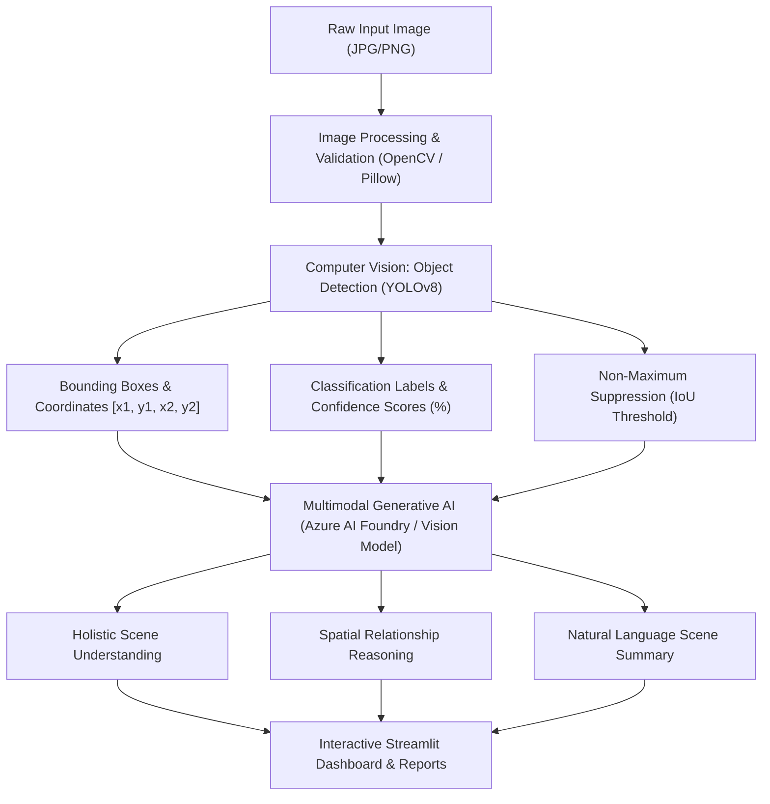
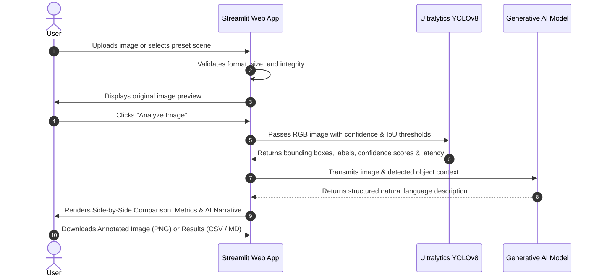

# Smart Object Detection and AI Image Description System

An end-to-end, interactive Computer Vision and Multimodal Generative AI web application built with **Streamlit**, **Ultralytics YOLOv8**, **OpenCV**, and **Vision-Language Generative AI** (Azure AI Foundry, OpenAI, Google Gemini, and a Local Contextual Synthesizer).

The project is designed as a demonstration of the **Microsoft AI-901 (Azure AI Fundamentals)** curriculum, bridging traditional Computer Vision (object localization, bounding boxes, confidence scoring, NMS) with modern Generative AI (multimodal scene understanding, spatial reasoning, and natural-language narration).

---

## 🌟 Key Highlights & Features

| Feature | Description |
| :--- | :--- |
| **🖼️ Image Upload & Validation** | Accepts JPG, JPEG, PNG, WEBP, and BMP formats up to 15MB. Automatically validates image integrity, EXIF orientation, and color channels. |
| **🎯 Pretrained YOLOv8 Detection** | Detects multiple common objects simultaneously using the official `yolov8n` model. Real-time inference with sub-100ms latency. |
| **🎛️ Dynamic Tuning Controls** | Interactive sliders for **Confidence Threshold** (10%–100%) and **IoU Threshold / Non-Maximum Suppression (NMS)** (10%–90%). |
| **🎨 Aesthetic Annotation Engine** | Draws crisp, anti-aliased bounding boxes with high-contrast color palette, pill badges, class names, and confidence percentages (e.g. `Person 94.2%`). |
| **🧠 Multimodal AI Scene Description** | Generates a grounded, natural-language scene description explaining key subjects, spatial relationships, interactions, and contextual summary. |
| **⚡ Multi-Provider Architecture** | Connects seamlessly to **Azure AI Foundry** (Azure OpenAI / Serverless inference), **OpenAI** (`gpt-4o`, `gpt-4o-mini`), **Google Gemini** (`gemini-1.5-flash`), or runs **100% offline with zero API keys** via the built-in Local Contextual Synthesizer. |
| **📊 Detection Analytics Dashboard** | Real-time metric cards (Total Count, Unique Categories, Average Confidence, Latencies) plus interactive category occurrence bar charts. |
| **📋 Tabular Registry & CSV Export** | Structured Pandas DataFrame table detailing object index, label, confidence score, spatial location (`Center-Foreground`, `Top-Left`, etc.), and bounding box coordinates. |
| **📥 One-Click Export Center** | Download the annotated image (PNG), detection results (CSV), and a comprehensive Markdown inspection report (MD/TXT). |
| **🛡️ Fallback Resilience** | If cloud APIs encounter rate limits, network timeouts, or missing keys, the application gracefully falls back to local heuristic scene synthesis without crashing. |

---

## 📁 Project Directory Structure

```text
smart-object-detection/
│
├── app.py                 # Streamlit web application dashboard & UI logic
├── detector.py            # YOLOv8 object detection wrapper, inference & annotation
├── image_caption.py       # Vision-language Generative AI module (Azure/OpenAI/Gemini/Local)
├── utils.py               # File validation, image transformation, spatial locators & CSS
├── test_system.py         # Automated unit test suite verifying all modules & edge cases
├── requirements.txt       # Python package dependencies
├── .env.example           # Environment variables configuration template
├── README.md              # Comprehensive project documentation & AI-901 guide
│
└── outputs/               # Directory for exported images, CSV reports, and inspection summaries
```

---

## 🎓 Microsoft AI-901 Syllabus Concept Mapping

This project is tailored for academic demonstrations and showcases fundamental objectives of the **Microsoft Certified: Azure AI Fundamentals (AI-901)** certification:



### Detailed Mapping:

1. **Computer Vision & Image Analysis**:
   - Understanding pixels, RGB matrix representations, dimensions, and image normalization.
   - Performed via Pillow and OpenCV in [utils.py](file:///c:/Users/Hp/OneDrive/Desktop/Project/utils.py).

2. **Image Classification vs Object Detection**:
   - **Classification** answers *"What is in this image?"* (assigning a single label to the entire image).
   - **Object Detection** answers *"What objects are in this image, and WHERE are they?"* (multi-label prediction with spatial coordinate bounding boxes `[x1, y1, x2, y2]`).
   - Performed via YOLOv8 in [detector.py](file:///c:/Users/Hp/OneDrive/Desktop/Project/detector.py).

3. **Model Confidence Scores & Non-Maximum Suppression (NMS)**:
   - **Confidence Score**: Probability (0.0 to 1.0) indicating how certain the model is about an object's category.
   - **Intersection over Union (IoU)**: Ratio of overlap between two bounding boxes to eliminate redundant duplicate boxes.
   - Handled interactively through sidebar sliders in [app.py](file:///c:/Users/Hp/OneDrive/Desktop/Project/app.py).

4. **Multimodal Generative AI & Vision-Language Models**:
   - Transcends simple bounding boxes by extracting higher-level semantic meaning: scene atmosphere, subject interactions, and narrative explanations.
   - Implemented via Azure AI Foundry / OpenAI / Gemini / Local Synthesizer in [image_caption.py](file:///c:/Users/Hp/OneDrive/Desktop/Project/image_caption.py).

5. **Guiding Principles for Responsible AI**:
   - **Reliability & Safety**: Rigorous file validation, input dimension checks, and automated error catching.
   - **Transparency**: Clear display of confidence percentages, bounding boxes, and execution latencies.
   - **Resilience & Inclusivity**: Built-in offline fallback ensures full functionality even without expensive cloud subscriptions or active internet connectivity.

---

## 🛠️ Technology Stack

- **Core Language**: Python 3.9+ (tested on Python 3.12)
- **Web Frontend**: [Streamlit](https://streamlit.io/) (modern reactive dashboard)
- **Computer Vision**: [OpenCV (opencv-python)](https://opencv.org/)
- **Object Detection**: [Ultralytics YOLOv8](https://github.com/ultralytics/ultralytics) (`yolov8n.pt` nano model)
- **Image Processing**: [Pillow (PIL)](https://python-pillow.org/)
- **Data Structuring**: [Pandas](https://pandas.pydata.org/) & [NumPy](https://numpy.org/)
- **Generative AI Providers**:
  - **Azure AI Foundry / Azure OpenAI** (Serverless inference / Azure OpenAI endpoints)
  - **OpenAI API** (`gpt-4o`, `gpt-4o-mini`)
  - **Google Gemini API** (`gemini-1.5-flash`)
  - **Local Contextual AI Synthesizer** (Custom spatial heuristic engine, requires 0 API keys)

---

## 🚀 Step-by-Step Installation & Setup

### 1. Prerequisites
Ensure you have Python 3.9 or higher installed. Check in terminal:
```bash
python --version
pip --version
```

### 2. Clone or Navigate to Project Directory
```bash
cd smart-object-detection
```

### 3. (Recommended) Create and Activate a Virtual Environment
- **Windows (Command Prompt / PowerShell)**:
  ```powershell
  python -m venv venv
  .\venv\Scripts\activate
  ```
- **macOS / Linux**:
  ```bash
  python3 -m venv venv
  source venv/bin/activate
  ```

### 4. Install Dependencies
Install all required libraries using `pip`:
```bash
pip install -r requirements.txt
```

---

## 🔑 Environment Configuration (.env)

The application includes an environment variable template `.env.example`.

To configure cloud Generative AI models:
1. Copy `.env.example` to `.env`:
   ```bash
   cp .env.example .env
   ```
2. Edit `.env` with your preferred credentials:

```ini
# Preferred default AI provider: 'local', 'azure', 'openai', or 'gemini'
DEFAULT_AI_PROVIDER=local

# 1. Azure AI Foundry / Azure OpenAI Configuration
AZURE_AI_ENDPOINT=https://<your-resource>.openai.azure.com/openai/deployments/gpt-4o/chat/completions?api-version=2024-02-15-preview
AZURE_AI_KEY=your_azure_api_key_here
AZURE_AI_MODEL=gpt-4o

# 2. OpenAI Configuration
OPENAI_API_KEY=your_openai_api_key_here
OPENAI_MODEL=gpt-4o-mini

# 3. Google Gemini Configuration
GEMINI_API_KEY=your_gemini_api_key_here
GEMINI_MODEL=gemini-1.5-flash
```

> [!NOTE]
> **No API Key? No Problem!**
> If you leave the `.env` blank or choose **"Local Contextual Synthesizer (Zero-Key)"** in the sidebar, the application runs entirely locally. YOLOv8 detects objects, and the local rule-based scene synthesizer generates descriptions with zero external API calls or costs!

---

## 🏃 Execution Instructions

### Running the Application

Launch the Streamlit dashboard:
```bash
streamlit run app.py
```

The application will start and automatically open in your default browser at:
```text
http://localhost:8501
```

### Running the Automated Test Suite

To verify that all modules, YOLO inference, image validation, and spatial locators function properly:
```bash
python test_system.py
```

---

## 🖥️ User Workflow & Step-by-Step Guide



1. **Upload or Select Image**:
   - Drag and drop your image (`.jpg`, `.jpeg`, `.png`, `.webp`, `.bmp`).
   - Or choose a pre-configured sample scene ("Urban Street & Vehicles", "Domestic Living Room", "Workstation & Tech").
2. **Adjust Detection Parameters**:
   - Adjust the **Confidence Threshold** slider (e.g. `0.25` to capture subtle objects, or `0.60` for only high-certainty objects).
   - Adjust **IoU Threshold** to control suppression of overlapping boxes.
3. **Select Generative AI Engine**:
   - Choose between Azure AI Foundry, OpenAI, Google Gemini, or the Local Synthesizer.
4. **Click "🚀 Analyze Image"**:
   - YOLO detects objects, draws labeled bounding boxes, and calculates statistics.
   - Generative AI produces a rich, structured description of scene dynamics.
5. **Explore & Export Results**:
   - **Visual Detection tab**: View side-by-side original vs annotated image.
   - **AI Image Description tab**: Read the comprehensive narrative breakdown.
   - **Detection Analytics tab**: View bar chart distributions of detected classes.
   - **Results Table tab**: Search and inspect the raw bounding box registry.
   - **Download Center**: Download the annotated image, CSV data file, or full Markdown inspection report.

---

## 📸 Sample Output Walkthrough

### Example: Urban Street Scene Upload

- **Input Image**: Urban roadway with pedestrians, cars, and a traffic light.
- **YOLOv8 Detection Output**:
  - Total Objects Detected: `5`
  - Unique Categories: `3` (`car`, `person`, `traffic light`)
  - Average Confidence: `91.4%`
  - Processing Latency: `32.6 ms`
- **Detection Table**:
  | Index | Object Label | Confidence Score | Confidence (%) | Location | Bounding Box |
  | :---: | :--- | :---: | :---: | :--- | :--- |
  | 1 | Car | 0.942 | 94.2% | Middle-Left | [200, 360, 480, 480] |
  | 2 | Person | 0.928 | 92.8% | Middle-Right | [580, 280, 620, 510] |
  | 3 | Car | 0.915 | 91.5% | Center-Foreground | [120, 380, 310, 460] |
  | 4 | Traffic light | 0.892 | 89.2% | Top-Right | [680, 40, 720, 160] |
  | 5 | Person | 0.865 | 86.5% | Lower-Right | [620, 340, 660, 520] |

- **Generative AI Output**:
  > **Scene Overview**: The image presents an active urban street setting featuring vehicular movement and pedestrian traffic during daylight hours.  
  > **Key Visible Entities**: Multiple cars occupy the main roadway on the left, while pedestrians are positioned along the right-hand sidewalk adjacent to an overhead traffic light.  
  > **Spatial Relationships & Interactions**: The vehicles and pedestrians maintain segregated spatial zones, indicating a safe commuting environment governed by road infrastructure.  
  > **Contextual Summary**: A classic downtown transit scene demonstrating high object clarity and structured urban activity.

---

## 💡 College Mini-Project / Viva Demonstration Q&A

**Q1: What is the difference between Image Classification and Object Detection?**  
> *Answer*: Image classification assigns a single label to an entire image (e.g., "Street"), whereas Object Detection locates multiple objects within the image, provides their specific categories, and outputs spatial coordinates (bounding boxes `[x1, y1, x2, y2]`).

**Q2: What is YOLO and why is it preferred over two-stage detectors like Faster R-CNN?**  
> *Answer*: YOLO ("You Only Look Once") is a single-stage detector. It frames object detection as a regression problem, predicting bounding boxes and class probabilities directly from full images in a single forward pass of the neural network, achieving real-time speeds (30–100+ FPS).

**Q3: How does Non-Maximum Suppression (NMS) work?**  
> *Answer*: Object detectors frequently produce multiple overlapping bounding boxes for the same physical object. NMS sorts boxes by confidence, selects the box with the highest score, and eliminates other overlapping boxes whose Intersection over Union (IoU) exceeds the selected threshold.

**Q4: Why combine YOLO with Generative AI?**  
> *Answer*: YOLO is specialized for rapid spatial localization and categorizing known classes, but it cannot describe context, relationships, intentions, or scene semantics. Generative AI (multimodal LLMs) bridges this gap by interpreting how objects interact to form a coherent story.

**Q5: How does this system uphold Responsible AI principles (AI-901)?**  
> *Answer*: By displaying explicit confidence scores (transparency), reporting execution latencies (accountability), preventing model hallucination through prompt grounding, and providing a local fallback engine (reliability and accessibility).

---

## 📄 License & Attribution
- Built with [Ultralytics YOLOv8](https://github.com/ultralytics/ultralytics) (GPL-3.0 / AGPL-3.0)
- Microsoft AI-901 curriculum alignment for academic demonstration.
